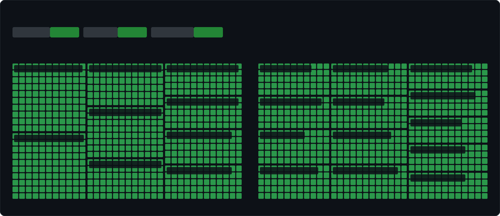

# LORGAR MSA10W Linux Control Stack & Driver

[](https://github.com/Sqrilizz/lorgarctl/actions/workflows/rust.yml)
[](https://github.com/Sqrilizz/lorgarctl/actions/workflows/kernel.yml)
[](LICENSE-MIT)
[](kernel/LICENSE)
[](https://kernel.org)

<table>
<tr>
<td width="300" align="center">

</td>
<td>

Complete, native Linux driver and control ecosystem for the **LORGAR MSA10W** wireless gaming mouse. No proprietary Windows software required.

- Pixart sensor, 100–26,000 DPI, 8 onboard stages
- Wired `093a:c600` and 2.4 GHz dongle `093a:c601`
- Native battery via `power_supply` / UPower (`lorgarctl battery --json`)
- `lorgarctl menu`, `lorgard` daemon, optional `hid-lorgar` DKMS module

**[Quick Start](#quick-start)** · **[CLI Guide](#cli-guide-lorgarctl)** · **[Daemon](#background-daemon-lorgard)** · **[Kernel](#linux-kernel-module-hid-lorgar)**

</td>
</tr>
</table>

## Status

[](protocol/msa10w.md) [](protocol/msa10w.md) [](kernel/)

[](protocol/msa10w.md)

<sub>* Firmware NVRAM: percentage of configuration packets and hardware registers reverse-engineered from vendor software (<code>mouse.MSA10WR.dll</code>) and verified live on hardware. 100% native Linux driver and control stack.</sub>

| Subsystem | Coverage | Documentation / Reference | Implementation |
| :--- | :---: | :--- | :--- |
| **Firmware NVRAM (Packets 0x01–0x09)** | **100.0%** | [`protocol/msa10w.md`](protocol/msa10w.md#complete-firmware-nvram-packet-map) | [`lorgar-core::protocol`](crates/lorgar-core/src/protocol.rs) |
| **HID Transport & Device Lock** | **100.0%** | [`protocol/msa10w.md`](protocol/msa10w.md#hid-reports--commands) | [`lorgar-core::device`](crates/lorgar-core/src/device.rs) |
| **Battery & Sleep Power States** | **100.0%** | [`protocol/msa10w.md`](protocol/msa10w.md#sleep-timer--inactivity-timeout) | CLI `lorgarctl sleep`, daemon & kernel |
| **Sensors & DPI Configuration** | **100.0%** | [`protocol/msa10w.md`](protocol/msa10w.md#packet-0x05--0x06---dpi-stages) | 8 stages (100–26,000 DPI), active switching |
| **RGB Effects & Palette** | **100.0%** | [`protocol/msa10w.md`](protocol/msa10w.md#packet-0x03---dpi-led-indicator-colors) | Modes (Static, Breathing, Wave, Cycle), hex RGB |
| **Linux Kernel Module (`hid-lorgar`)** | **100.0%** | [`kernel/`](kernel) | `/sys/class/power_supply`, sysfs controls, DKMS |
| **Daemon & CLI Management Stack** | **100.0%** | [`crates/`](crates) | `lorgarctl` (CLI/TUI menu), `lorgard` (IPC daemon) |

> **Coverage vs. live validation:** percentages above measure reverse-engineered
> firmware packets/registers, not end-to-end live proof. Kernel query-transport
> behavior, reconnect/suspend/resume, `c600` vs `c601`, and multi-kernel DKMS
> reboot still require a hardware live session (see
> [`docs/AI_FULL_IMPROVEMENT_PLAN.md`](docs/AI_FULL_IMPROVEMENT_PLAN.md) P0-1…P0-4
> and Definition of Done). Component versions are tracked in
> [`VERSIONS.md`](VERSIONS.md); Rust `0.1.0` and kernel `2.3.4` are independent lines.

---

## What's Included

| Component | Path | Description |
| :--- | :--- | :--- |
| **`lorgarctl`** | [`crates/lorgarctl`](crates/lorgarctl) | Powerful CLI utility for mouse controls, interactive menu (`menu`), scripting, diagnostics (`doctor`), shell completions, and bar integration (Waybar, Polybar, KDE). |
| **`lorgard`** | [`crates/lorgard`](crates/lorgard) | Lightweight background user daemon managing profiles, auto-switching, and IPC over `/run/user/$UID/lorgar/lorgard.sock`. |
| **`hid-lorgar`** | [`kernel/`](kernel) | Optional Linux kernel module (DKMS) providing native `/sys/class/power_supply` battery integration and sysfs controls. |
| **`lorgar-core`** | [`crates/lorgar-core`](crates/lorgar-core) | Pure Rust HID protocol parser, device discovery, and transport library. |
| **Plasmoid** | [`plasmoid/`](plasmoid) | Native KDE Plasma 6 panel widget for battery monitoring. |

---

## Quick Start

### 1. Install System Dependencies

```bash
# Arch Linux / CachyOS / Manjaro
sudo pacman -S base-devel pkgconf hidapi dbus

# Ubuntu / Debian
sudo apt install build-essential pkg-config libudev-dev libhidapi-dev libdbus-1-dev

# Fedora
sudo dnf install gcc pkg-config systemd-devel hidapi-devel dbus-devel
```

### 2. Configure Non-Root Device Permissions (`udev`)

By default, Linux limits raw HID device nodes (`/dev/hidraw*`) to root. Install the udev rules to enable normal user access:

```bash
sudo cp udev/99-lorgar-msa10w.rules /etc/udev/rules.d/
sudo udevadm control --reload-rules
sudo udevadm trigger
```

### 3. Build & Install

Build all workspace binaries in optimized release mode:

```bash
cargo build --workspace --release --locked
```

Compiled binaries will be available in `target/release/`:
* `target/release/lorgarctl` — CLI control utility
* `target/release/lorgard` — Background daemon

To install them to `~/.local/bin/`:

```bash
install -Dm755 target/release/lorgarctl ~/.local/bin/
install -Dm755 target/release/lorgard ~/.local/bin/
```

---

## CLI Guide (`lorgarctl`)

### Interactive TUI Menu

Launch the interactive control menu to inspect battery, switch DPI stages, adjust RGB, configure sleep timeout, or manage profiles without memorizing flags:

```bash
lorgarctl menu
```

### Status & Hardware Diagnostics

```bash
# General summary (connection, battery level, current profile)
lorgarctl status

# Detailed environment diagnostic (udev ACLs, daemon reachability, kernel module status)
lorgarctl doctor
lorgarctl doctor --json
```

### Battery Monitoring

```bash
# Human-readable battery status
lorgarctl battery

# Short format for panel widgets (e.g. "92%")
lorgarctl battery --short

# Structured JSON (for Waybar, Polybar, or scripts)
lorgarctl battery --json
# Output: {"percentage":92,"icon":"🖲️","text":"92%","tooltip":"LORGAR MSA10W: 92%","class":"good"}

# Send desktop notification if battery is low (<= 20%)
lorgarctl battery --notify --threshold 20
```

#### Waybar Configuration Example (`~/.config/waybar/config.jsonc`)
```json
"custom/mouse_battery": {
    "exec": "lorgarctl --daemon battery --json",
    "return-type": "json",
    "interval": 120,
    "format": "{icon} {text}",
    "format-icons": {
        "good": "󰁹",
        "warning": "󰁻",
        "critical": "󰁺"
    }
}
```

### DPI & Sensor Configuration

The MSA10W supports 8 onboard DPI stages (0..7) and up to 26,000 DPI:

```bash
# Set DPI for a specific stage (Stage 0..7, DPI 100..26000)
lorgarctl dpi set 0 800
lorgarctl dpi set 1 1600
lorgarctl dpi set 2 3200

# Switch active DPI stage immediately
lorgarctl dpi active 1
```

### Sleep Timeout (Inactivity Hibernation)

Set the mouse hardware sleep timer (1 to 10 minutes) before the sensor and MCU enter low-power hibernation:

```bash
# Set inactivity sleep timer to 5 minutes (persists in mouse NVRAM)
lorgarctl sleep 5
```

### Polling Rate

```bash
# Set report rate (125, 250, 500, or 1000 Hz)
lorgarctl polling set 1000
```

### RGB Lighting Modes & Colors

```bash
# Set lighting effect mode
lorgarctl rgb mode static
lorgarctl rgb mode breathing
lorgarctl rgb mode color-cycle
lorgarctl rgb mode wave
lorgarctl rgb mode off

# Set static RGB color (Hex RRGGBB format)
lorgarctl rgb color ff5500
lorgarctl rgb color "#00d0ff"
```

### Profiles & Auto-Switching

```bash
# Create and edit profiles
lorgarctl profile create gaming
lorgarctl profile set gaming --dpi-stage 0=800 --dpi-stage 1=1600 --polling 1000 --rgb static --color ff5500
lorgarctl profile apply gaming
lorgarctl profile list
```

### Live Event Streaming & Monitoring

```bash
# Stream live battery, DPI stage changes, and sleep events in real time
lorgarctl monitor
```

### Shell Completions

Generate auto-completions for your shell:

```bash
# Bash
lorgarctl completions bash > ~/.local/share/bash-completion/completions/lorgarctl

# Zsh
lorgarctl completions zsh > ~/.zfunc/_lorgarctl

# Fish
lorgarctl completions fish > ~/.config/fish/completions/lorgarctl.fish
```

Or generate all shells at once (no install needed):

```bash
bash tools/generate-completions.sh target/completions
```

Lean build without the legacy tray (avoids the `ksni`/clap-v2 duplicate tree):

```bash
cargo build -p lorgarctl --no-default-features --locked
```

---

## Background Daemon (`lorgard`)

`lorgard` runs in the user session to coordinate device access, synchronize state between CLI invocations, and automatically switch profiles based on the active application window (supports native KDE Plasma Wayland via KWin DBus and X11 via EWMH).

### Enable User Service:

```bash
# Install user systemd unit
mkdir -p ~/.config/systemd/user/
cp systemd/lorgard.service ~/.config/systemd/user/
systemctl --user daemon-reload
systemctl --user enable --now lorgard.service
```

### Inspect Daemon:
```bash
systemctl --user status lorgard.service
lorgarctl --daemon status
```

> **Single HID owner:** `lorgard`, `lorgarctl tray`, and `lorgarctl upower`
> each open HID directly. Enable only one of
> `lorgard.service` / `lorgarctl-tray.service` / `lorgarctl-upower.service`
> at a time (units now declare `Conflicts=`). Use `lorgarctl --daemon ...`
> while `lorgard` runs; direct mode returns busy by design.

### Uninstall (user services + binaries):

```bash
systemctl --user disable --now lorgard.service lorgarctl-tray.service lorgarctl-upower.service
rm -f ~/.config/systemd/user/lorgard.service ~/.local/bin/lorgarctl ~/.local/bin/lorgard
systemctl --user daemon-reload
```

---

## Linux Kernel Module (`hid-lorgar`)

The optional kernel driver provides native Linux kernel integration:
* Registers a standard `/sys/class/power_supply/lorgar_mouse_battery_*` device (shows mouse battery in GNOME/KDE system battery menus, UPower, and tray widgets out-of-the-box).
* Sysfs controls: `/sys/bus/hid/drivers/hid-lorgar/<device>/` (`dpi`, `dpi_stage`, `polling_rate`, `led_mode`, `led_color`, `hardware_status`).
* Zero background polling overhead when the mouse is asleep.

### Install via DKMS:

```bash
cd kernel
sudo ./install-dkms.sh
```

### Live Verification:

```bash
./kernel/verify-live.sh
```

---

## Development & Test Suite

Run the full project test suite and validation gates:

```bash
# Run all workspace unit tests, clippy, formatting, and kernel validation
./tools/check.sh
```

---

## License

* **Rust Workspace** (`lorgar-core`, `lorgarctl`, `lorgard`): Dual-licensed under [MIT](LICENSE-MIT) or [Apache-2.0](LICENSE-APACHE).
* **Kernel Module** (`hid-lorgar`): Licensed under [GPL-2.0-or-later](kernel/LICENSE).
