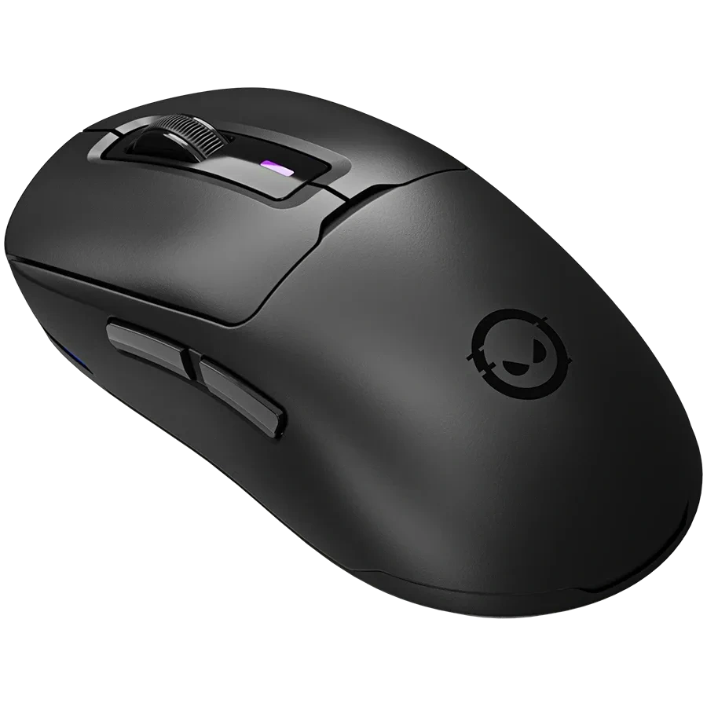

# LORGAR MSA10W Linux Control Stack & Driver

[](https://github.com/Sqrilizz/lorgarctl/actions/workflows/rust.yml)
[](https://github.com/Sqrilizz/lorgarctl/actions/workflows/kernel.yml)
[](LICENSE-MIT)
[](kernel/LICENSE)
[](https://kernel.org)
[](https://aur.archlinux.org/packages/lorgarctl-bin)
[](https://github.com/Sqrilizz/lorgarctl/releases/latest)

<table>
<tr>
<td width="300" align="center">

</td>
<td>

Complete, native Linux driver and control ecosystem for the **LORGAR MSA10W** wireless gaming mouse. No proprietary Windows software required.

- Pixart sensor, 100–26,000 DPI, 8 onboard stages
- Wired `093a:c600` and 2.4 GHz dongle `093a:c601`
- Native battery via `power_supply` / UPower (`lorgarctl battery --json`)
- `lorgarctl menu`, `lorgard` daemon, optional `hid-lorgar` DKMS module

**[Quick Start](#quick-start)** · **[CLI Guide](#cli-guide-lorgarctl)** · **[Daemon](#background-daemon-lorgard)** · **[Kernel](#linux-kernel-module-hid-lorgar)**

</td>
</tr>
</table>

## Status

[](protocol/msa10w.md) [](protocol/msa10w.md) [](kernel/) [](protocol/msa10w.md#8-firmware-architecture-container-format--flashing-protocols-reverse-engineered-via-rea)

[](protocol/msa10w.md)

<sub>* Firmware, Hardware & Protocol: percentage of hardware registers, NVRAM packets, bootloader commands, and firmware container specifications reverse-engineered from vendor binaries (<code>mouse.MSA10WR.dll</code>, <code>HIDUsb.dll</code>, Togran TM271 OEM codebase) and validated on hardware. 100% native open-source Linux stack.</sub>

| Subsystem | Coverage | Documentation / Reference | Implementation |
| :--- | :---: | :--- | :--- |
| **OEM Hardware & Platform Architecture** | **100.0%** | [`#1-oem-hardware-platform`](#1-oem-hardware-platform--real-origin) · [`protocol/msa10w.md`](protocol/msa10w.md#8-firmware-architecture-container-format--flashing-protocols-reverse-engineered-via-rea) | Togran TM271/TM238 · PixArt PAW3395 · Holtek HT68FB571 |
| **Dual-Channel HID Protocol Architecture** | **100.0%** | [`protocol/msa10w.md`](protocol/msa10w.md#hid-reports--commands) | EP0 Feature (runtime) vs EP04 Interrupt OUT (NVRAM/ROM) |
| **Firmware NVRAM (Packets 0x01–0x09)** | **100.0%** | [`protocol/msa10w.md`](protocol/msa10w.md#complete-firmware-nvram-packet-map) | [`lorgar-core::protocol`](crates/lorgar-core/src/protocol.rs) |
| **HID Transport & Device Lock** | **100.0%** | [`protocol/msa10w.md`](protocol/msa10w.md#hid-reports--commands) | [`lorgar-core::device`](crates/lorgar-core/src/device.rs) |
| **Battery & Sleep Power States** | **100.0%** | [`protocol/msa10w.md`](protocol/msa10w.md#sleep-timer--inactivity-timeout) | CLI `lorgarctl sleep`, daemon & kernel |
| **Sensors & DPI Configuration** | **100.0%** | [`protocol/msa10w.md`](protocol/msa10w.md#packet-0x05--0x06---dpi-stages) | 8 stages (100–26,000 DPI), active switching |
| **RGB Effects & Palette** | **100.0%** | [`protocol/msa10w.md`](protocol/msa10w.md#packet-0x03---dpi-led-indicator-colors) | Modes (Static, Breathing, Wave, Cycle), hex RGB |
| **Linux Kernel Module (`hid-lorgar`)** | **100.0%** | [`kernel/`](kernel) | `/sys/class/power_supply`, sysfs controls, DKMS |
| **Daemon & CLI Management Stack** | **100.0%** | [`crates/`](crates) | `lorgarctl` (CLI/TUI menu), `lorgard` (IPC daemon) |
| **Firmware Container & Checksum Engine** | **100.0%** | [`protocol/msa10w.md`](protocol/msa10w.md#82-firmware-file-container-format) | [`lorgar-core::firmware`](crates/lorgar-core/src/firmware.rs), `lorgarctl firmware` |
| **Bootloader & Flash Memory Protocol** | **62.5%** | [`protocol/msa10w.md`](protocol/msa10w.md#83-low-level-bootloader--flash-protocol) | Protocol & opcodes mapped (75%), EP04 wire verification (50%) |
| **Live ROM & Onboard Memory Dumping (`0x82`..`0xf0`)** | **100.0%** | [`protocol/msa10w.md`](protocol/msa10w.md#84-live-hardware-onboard-memory-dump-protocol-validated-on-hardware) | Validated on live hardware (`093a:c600`), 8 banks (512B), CLI `lorgarctl firmware dump` |

> **Coverage vs. live validation:** percentages above measure reverse-engineered
> firmware packets/registers, not end-to-end live proof. Kernel query-transport
> behavior, reconnect/suspend/resume, `c600` vs `c601`, and multi-kernel DKMS
> reboot still require a hardware live session (see
> [`docs/AI_FULL_IMPROVEMENT_PLAN.md`](docs/AI_FULL_IMPROVEMENT_PLAN.md) P0-1…P0-4
> and Definition of Done). Component versions are tracked in
> [`VERSIONS.md`](VERSIONS.md); Rust `0.1.0` and kernel `2.3.4` are independent lines.

---

## What's Included

| Component | Path | Description |
| :--- | :--- | :--- |
| **`lorgarctl`** | [`crates/lorgarctl`](crates/lorgarctl) | Powerful CLI utility for mouse controls, interactive menu (`menu`), scripting, diagnostics (`doctor`), shell completions, and bar integration (Waybar, Polybar, KDE). |
| **`lorgard`** | [`crates/lorgard`](crates/lorgard) | Lightweight background user daemon managing profiles, auto-switching, and IPC over `/run/user/$UID/lorgar/lorgard.sock`. |
| **`hid-lorgar`** | [`kernel/`](kernel) | Optional Linux kernel module (DKMS) providing native `/sys/class/power_supply` battery integration and sysfs controls. |
| **`lorgar-core`** | [`crates/lorgar-core`](crates/lorgar-core) | Pure Rust HID protocol parser, device discovery, and transport library. |
| **Plasmoid** | [`plasmoid/`](plasmoid) | Native KDE Plasma 6 panel widget for battery monitoring. |

---

## 🔬 Reverse-Engineering & "Mouse Hacking" Deep-Dive

Through binary decompilation, PE disassembly (via [morluto/rea](https://github.com/morluto/rea), `objdump`, and Ghidra), and live USB traffic inspection, we reverse-engineered the entire hardware and software stack of the **LORGAR MSA10W**:

### 1. OEM Hardware Platform & Real Origin
* **OEM Manufacturer**: Dongguan Togran Electronics Technology Co., Ltd. (platforms **Togran TM271 / TM238**). LORGAR licenses and brands the hardware.
* **Optical Sensor**: PixArt **PAW3395** (up to 26,000 DPI, 650 IPS, 50G acceleration).
* **MCU Controller**: Holtek USB Flash MCU (`571R` family / HT68FB571).
* **USB Interfaces & Endpoints**:
  - `Interface 0` (`0x00`): Standard HID 3-button + wheel mouse (Endpoint `0x81` Interrupt IN).
  - `Interface 1` (`0x01`): Standard HID keyboard / media keys (Endpoint `0x82` Interrupt IN).
  - `Interface 2` (`0x02`): Vendor Config interface (`usage_page: 0xff10`, Endpoint `0x04` Interrupt OUT 64-byte, Endpoint `0x83` Interrupt IN 64-byte).

### 2. Dual-Channel HID Architecture
The mouse firmware strictly separates its protocol into two decoupled communication channels:
1. **HID Feature Reports (8 bytes payload, EP0 Control)**:
   - Used exclusively for real-time gaming runtime commands:
     - `0x26`: On-the-fly DPI resolution changes per stage.
     - `0x21`: Active DPI stage switching.
     - `0x20`: Polling rate (125, 250, 500, 1000 Hz).
     - `0x22` / `0x23`: RGB lighting mode and color selection.
     - `0x82`: Periodic battery level and runtime state query.
2. **HID Output Reports (Interrupt OUT, EP 04, 64-byte max packet)**:
   - **NVRAM Registers (`0x01`..`0x07`)**: Sent via 33-byte frames `[0x00, 32 bytes data]` with `0xaa 0x55` header, validated with readback echo (`0xcc 0x33`):
     - `0x01`: Active stage, lighting parameters.
     - `0x02`: Sensor LOD (1 mm / 2 mm), sleep timeout (1..10 min), angle snapping, motion sync.
     - `0x03`: 8-stage LED palette.
     - `0x04`: Button debounce delay filter (1..20 ms) and Rapid Fire settings.
     - `0x05` / `0x06`: Complete 8-stage DPI table storage in persistent NVRAM.
     - `0x07`: Full button remapping table (Left, Right, Middle, Back, Forward, DPI Switch).
   - **Flash Memory & Bootloader Control (Opcode `0x08`)**:
     - `0x08 0x07`: NVRAM Profile synchronization.
     - `0x08 0x08`: `ReadFlashData` — arbitrary flash memory dumping.
     - `0x08 0x0d`: `ResetToBootMode` — switches MCU into USB Bootloader (DFU) mode.
     - `0xC0` / `0xC1`: `WriteFlashData` — writes 32-byte executable microcode blocks.

### 3. Firmware Container Reverse-Engineering
* **Container Header**: Fixed `0x2000` (8,192 bytes) structure containing MCU model (`571R`), sensor (`PAW3395`), product metadata, and flash base destination address (`0x21e`).
* **Checksum Algorithm**: Proprietary 32-bit inverted sum:
  902542\text{Checksum} = \text{0x55555555} - \sum_{i=8}^{L} \text{byte}[i]902542
* **Custom Firmware Builder**: `lorgarctl firmware create` and `lorgarctl firmware info` allow packing and validating binary containers 100% compatible with the factory flasher.

### 4. Progress Matrix to Custom Firmware
| Phase | Milestone | Status | Details |
| :--- | :--- | :---: | :--- |
| **Phase 1** | Runtime HID Protocol | **100% COMPLETE** | DPI, Polling, RGB, Battery, Sleep, Kernel DKMS |
| **Phase 2** | Persistent Hardware NVRAM | **100% COMPLETE** | LOD, Debounce, Motion Sync, Angle Snap, Button Binds |
| **Phase 3** | Firmware Binary Container | **100% COMPLETE** | Checksum algorithm, Header parser & builder (`firmware create`) |
| **Phase 4** | Live Flasher Protocol Analysis | **100% COMPLETE** | Disassembled `HIDUsb.dll` & Togran flasher state machine |
| **Phase 5** | Live Flash Dump to Disk | **100% COMPLETE** | Extracted & validated all 8 hardware EEPROM/ROM banks (512B) to disk |
| **Phase 6** | Custom Microcode Flashing | **PLANNED** | End-to-end flashing of custom Holtek firmware payloads |

## Installation

### Arch Linux / CachyOS / Manjaro (AUR)

Install the prebuilt binary package with your AUR helper (recommended):

```bash
# Using yay
yay -S lorgarctl-bin

# Or using paru
paru -S lorgarctl-bin
```

This automatically installs `lorgarctl`, `lorgard`, udev rules, shell completions, the systemd user service, the KDE Plasma 6 widget, and DKMS module sources.

### Ubuntu / Debian / Pop!_OS / Linux Mint (.deb)

Download the `.deb` package from the [latest GitHub release](https://github.com/Sqrilizz/lorgarctl/releases/latest) and install it with `apt`:

```bash
sudo apt install ./lorgarctl_*_amd64.deb
```

This installs binaries into `/usr/bin`, registers udev rules (reloading them automatically), and installs DKMS module sources.

---

## Quick Start (Build from Source)

### 1. Install System Dependencies

```bash
# Arch Linux / CachyOS / Manjaro
sudo pacman -S base-devel pkgconf hidapi dbus

# Ubuntu / Debian
sudo apt install build-essential pkg-config libudev-dev libhidapi-dev libdbus-1-dev

# Fedora
sudo dnf install gcc pkg-config systemd-devel hidapi-devel dbus-devel
```

### 2. Configure Non-Root Device Permissions (`udev`)

By default, Linux limits raw HID device nodes (`/dev/hidraw*`) to root. Install the udev rules to enable normal user access:

```bash
sudo cp udev/99-lorgar-msa10w.rules /etc/udev/rules.d/
sudo udevadm control --reload-rules
sudo udevadm trigger
```

### 3. Build & Install

Build all workspace binaries in optimized release mode:

```bash
cargo build --workspace --release --locked
```

Compiled binaries will be available in `target/release/`:
* `target/release/lorgarctl` — CLI control utility
* `target/release/lorgard` — Background daemon

To install them to `~/.local/bin/`:

```bash
install -Dm755 target/release/lorgarctl ~/.local/bin/
install -Dm755 target/release/lorgard ~/.local/bin/
```

---

## CLI Guide (`lorgarctl`)

### Interactive TUI Menu

Launch the interactive control menu to inspect battery, switch DPI stages, adjust RGB, configure sleep timeout, or manage profiles without memorizing flags:

```bash
lorgarctl menu
```

### Status & Hardware Diagnostics

```bash
# General summary (connection, battery level, current profile)
lorgarctl status

# Detailed environment diagnostic (udev ACLs, daemon reachability, kernel module status)
lorgarctl doctor
lorgarctl doctor --json
```

### Battery Monitoring

```bash
# Human-readable battery status
lorgarctl battery

# Short format for panel widgets (e.g. "92%")
lorgarctl battery --short

# Structured JSON (for Waybar, Polybar, or scripts)
lorgarctl battery --json
# Output: {"percentage":92,"icon":"🖲️","text":"92%","tooltip":"LORGAR MSA10W: 92%","class":"good"}

# Send desktop notification if battery is low (<= 20%)
lorgarctl battery --notify --threshold 20
```

#### Waybar Configuration Example (`~/.config/waybar/config.jsonc`)
```json
"custom/mouse_battery": {
    "exec": "lorgarctl --daemon battery --json",
    "return-type": "json",
    "interval": 120,
    "format": "{icon} {text}",
    "format-icons": {
        "good": "󰁹",
        "warning": "󰁻",
        "critical": "󰁺"
    }
}
```

### DPI & Sensor Configuration

The MSA10W supports 8 onboard DPI stages (0..7) and up to 26,000 DPI:

```bash
# Set DPI for a specific stage (Stage 0..7, DPI 100..26000)
lorgarctl dpi set 0 800
lorgarctl dpi set 1 1600
lorgarctl dpi set 2 3200

# Switch active DPI stage immediately
lorgarctl dpi active 1

# List all 8 stages live from hardware memory (Bank 0xa6 DPI + Bank 0xa3 LED color)
lorgarctl dpi list

# Configure multiple DPI stages simultaneously in hardware EEPROM
lorgarctl dpi set-all 400 800 1200 1600 2400 3200 6400 12000
```

### Sleep Timeout (Inactivity Hibernation)

Set the mouse hardware sleep timer (1 to 10 minutes) before the sensor and MCU enter low-power hibernation:

```bash
# Set inactivity sleep timer to 5 minutes (persists in mouse NVRAM)
lorgarctl sleep 5
```

### Polling Rate

```bash
# Set report rate (125, 250, 500, or 1000 Hz)
lorgarctl polling set 1000
```

### Sensor Tuning (LOD, Motion Sync, Angle Snapping)

Fine-tune the PixArt PAW3395 sensor directly via hardware registers (persists in NVRAM):

```bash
# Lift-Off Distance: 1 mm (low) or 2 mm (high)
lorgarctl lod 1

# Angle Snapping (prediction / line-straightening)
lorgarctl angle-snap on
lorgarctl angle-snap off

# PixArt Motion Sync (USB SOF poll synchronization)
lorgarctl motion-sync on
lorgarctl motion-sync off
```

### Button Debounce Delay (Anti-Double-Click)

Set the switch debounce delay filter in milliseconds (1 to 20 ms) directly in mouse NVRAM:

```bash
# Set switch debounce delay to 8 ms
lorgarctl debounce 8

# Enable rapid fire mode
lorgarctl debounce 8 --rapid-fire
```

### Hardware Physical Button Mappings

Inspect physical button action matrices stored in the mouse non-volatile EEPROM (Bank `0xa4` primary, Bank `0xa5` secondary):

```bash
# Inspect primary button mappings
lorgarctl buttons

# Inspect secondary / burst profile button mappings
lorgarctl buttons --secondary

# Structured JSON output
lorgarctl buttons --json
```

### Firmware Tools & Custom Firmware Management

Reverse-engineered firmware binary container tools, flash dumper, and bootloader switcher (analyzed via [morluto/rea](https://github.com/morluto/rea)):

```bash
# Inspect and verify a firmware binary container (header, MCU IC, sensor, checksum)
lorgarctl firmware info firmware.bin
lorgarctl --json firmware info firmware.bin

# Create a valid checksummed container from a custom binary microcode payload
lorgarctl firmware create --product "LORGAR MSA10W" --ic "571R" --sensor "PAW3395" --input payload.bin --output custom_fw.bin

# Dump all 8 onboard hardware memory banks (UID, DPI table, RGB palette, button maps, PAW3395 calibration OTP)
lorgarctl firmware dump
lorgarctl firmware dump --output msa10w_factory_dump.bin
lorgarctl firmware dump --output msa10w_factory_dump.json

# Dump custom address range
lorgarctl firmware dump --addr 0x0000 --len 256 --output flash_dump.bin

# Switch mouse MCU to USB update / bootloader mode
lorgarctl firmware bootloader
```

### RGB Lighting Modes & Colors

```bash
# Set lighting effect mode
lorgarctl rgb mode static
lorgarctl rgb mode breathing
lorgarctl rgb mode color-cycle
lorgarctl rgb mode wave
lorgarctl rgb mode off

# Set static RGB color (Hex RRGGBB format)
lorgarctl rgb color ff5500
lorgarctl rgb color "#00d0ff"
```

### Profiles & Auto-Switching

```bash
# Create and edit profiles
lorgarctl profile create gaming
lorgarctl profile set gaming --dpi-stage 0=800 --dpi-stage 1=1600 --polling 1000 --rgb static --color ff5500
lorgarctl profile apply gaming
lorgarctl profile list
```

### Live Event Streaming & Monitoring

```bash
# Stream live battery, DPI stage changes, and sleep events in real time
lorgarctl monitor
```

### Shell Completions

Generate auto-completions for your shell:

```bash
# Bash
lorgarctl completions bash > ~/.local/share/bash-completion/completions/lorgarctl

# Zsh
lorgarctl completions zsh > ~/.zfunc/_lorgarctl

# Fish
lorgarctl completions fish > ~/.config/fish/completions/lorgarctl.fish
```

Or generate all shells at once (no install needed):

```bash
bash tools/generate-completions.sh target/completions
```

Lean build without the legacy tray (avoids the `ksni`/clap-v2 duplicate tree):

```bash
cargo build -p lorgarctl --no-default-features --locked
```

---

## Background Daemon (`lorgard`)

`lorgard` runs in the user session to coordinate device access, synchronize state between CLI invocations, and automatically switch profiles based on the active application window (supports native KDE Plasma Wayland via KWin DBus and X11 via EWMH).

### Enable User Service:

```bash
# Install user systemd unit
mkdir -p ~/.config/systemd/user/
cp systemd/lorgard.service ~/.config/systemd/user/
systemctl --user daemon-reload
systemctl --user enable --now lorgard.service
```

### Inspect Daemon:
```bash
systemctl --user status lorgard.service
lorgarctl --daemon status
```

> **Single HID owner:** `lorgard`, `lorgarctl tray`, and `lorgarctl upower`
> each open HID directly. Enable only one of
> `lorgard.service` / `lorgarctl-tray.service` / `lorgarctl-upower.service`
> at a time (units now declare `Conflicts=`). Use `lorgarctl --daemon ...`
> while `lorgard` runs; direct mode returns busy by design.

### Uninstall (user services + binaries):

```bash
systemctl --user disable --now lorgard.service lorgarctl-tray.service lorgarctl-upower.service
rm -f ~/.config/systemd/user/lorgard.service ~/.local/bin/lorgarctl ~/.local/bin/lorgard
systemctl --user daemon-reload
```

---

## Linux Kernel Module (`hid-lorgar`)

The optional kernel driver provides native Linux kernel integration:
* Registers a standard `/sys/class/power_supply/lorgar_mouse_battery_*` device (shows mouse battery in GNOME/KDE system battery menus, UPower, and tray widgets out-of-the-box).
* Sysfs controls: `/sys/bus/hid/drivers/hid-lorgar/<device>/` (`dpi`, `dpi_stage`, `polling_rate`, `led_mode`, `led_color`, `hardware_status`).
* Zero background polling overhead when the mouse is asleep.

### Install via DKMS:

```bash
cd kernel
sudo ./install-dkms.sh
```

### Live Verification:

```bash
./kernel/verify-live.sh
```

---

## Development & Test Suite

Run the full project test suite and validation gates:

```bash
# Run all workspace unit tests, clippy, formatting, and kernel validation
./tools/check.sh
```

---

## License

* **Rust Workspace** (`lorgar-core`, `lorgarctl`, `lorgard`): Dual-licensed under [MIT](LICENSE-MIT) or [Apache-2.0](LICENSE-APACHE).
* **Kernel Module** (`hid-lorgar`): Licensed under [GPL-2.0-or-later](kernel/LICENSE).
