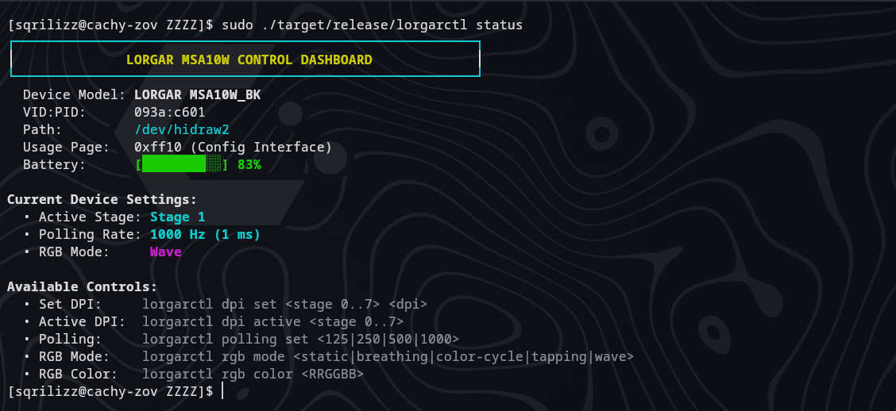

# LORGAR MSA10W Linux Control Stack & Driver

[](https://github.com/Sqrilizz/lorgarctl/actions/workflows/rust.yml)
[](https://github.com/Sqrilizz/lorgarctl/actions/workflows/kernel.yml)
[](LICENSE-MIT)
[](kernel/LICENSE)
[](https://kernel.org)

Complete, native Linux driver and control ecosystem for the **LORGAR MSA10W** wireless gaming mouse (Pixart sensor, USB VID: `0x093a`, Wired PID: `0xc600`, Wireless 2.4 GHz Dongle PID: `0xc601`). No proprietary Windows software required.

<p align="center">
  
</p>

---

## What's Included

| Component | Path | Description |
| :--- | :--- | :--- |
| **`lorgar-app`** | [`crates/lorgar-app`](crates/lorgar-app) | Native GTK4 desktop application with real-time battery status, 8-stage DPI tuning, RGB effects, and profile manager. |
| **`lorgarctl`** | [`crates/lorgarctl`](crates/lorgarctl) | Fast CLI utility for scripting, diagnostics (`doctor`), shell completions, and bar integration (Waybar, Polybar, KDE). |
| **`lorgard`** | [`crates/lorgard`](crates/lorgard) | Lightweight background user daemon managing profiles, auto-switching, and IPC over `/run/user/$UID/lorgar/lorgard.sock`. |
| **`hid-lorgar`** | [`kernel/`](kernel) | Optional Linux kernel module (DKMS) providing native `/sys/class/power_supply` battery integration and sysfs controls. |
| **`lorgar-core`** | [`crates/lorgar-core`](crates/lorgar-core) | Pure Rust HID protocol parser, device discovery, and transport library. |
| **Plasmoid** | [`plasmoid/`](plasmoid) | Native KDE Plasma 6 panel widget for battery monitoring. |

---

## Quick Start

### 1. Install System Dependencies

```bash
# Arch Linux / CachyOS / Manjaro
sudo pacman -S base-devel pkgconf hidapi dbus gtk4

# Ubuntu / Debian
sudo apt install build-essential pkg-config libudev-dev libhidapi-dev libdbus-1-dev libgtk-4-dev

# Fedora
sudo dnf install gcc pkg-config systemd-devel hidapi-devel dbus-devel gtk4-devel
```

### 2. Configure Non-Root Device Permissions (`udev`)

By default, Linux limits raw HID device nodes (`/dev/hidraw*`) to root. Install the udev rules to enable normal user access:

```bash
sudo cp udev/99-lorgar-msa10w.rules /etc/udev/rules.d/
sudo udevadm control --reload-rules
sudo udevadm trigger
```

### 3. Build & Install

Build all workspace binaries in optimized release mode:

```bash
cargo build --workspace --release --locked
```

Compiled binaries will be available in `target/release/`:
* `target/release/lorgar-app` — GTK4 GUI
* `target/release/lorgarctl` — CLI tool
* `target/release/lorgard` — Background daemon

To install them to `~/.local/bin/`:

```bash
install -Dm755 target/release/lorgarctl ~/.local/bin/
install -Dm755 target/release/lorgard ~/.local/bin/
install -Dm755 target/release/lorgar-app ~/.local/bin/

# Install desktop entry and icons
install -Dm644 desktop/io.github.Sqrilizz.LorgarControl.desktop ~/.local/share/applications/
```

---

## Desktop GUI (`lorgar-app`)

Launch the settings application:

```bash
lorgar-app
```

<p align="center">
  
</p>

### Features:
* **8 DPI Stages**: Independent configuration of stages 0..7 (100 to 12,000 DPI) and real-time active stage toggling.
* **Sensor Polling Rates**: Select 125 Hz (8 ms), 250 Hz (4 ms), 500 Hz (2 ms), or 1000 Hz (1 ms).
* **RGB Lighting**: Full hardware lighting mode selection (`static`, `breathing`, `color-cycle`, `tapping`, `wave`) and custom 24-bit RGB colors.
* **Profile Management**: Save and switch persistent gaming and productivity profiles.
* **Safe Application**: "Apply" communicates live with the mouse; "Save" persists profiles to `$XDG_CONFIG_HOME/lorgar/config.json`.
* **Optional 3D Visualization**: Experimental interactive mouse view (`lorgar-app --experimental-3d`).

---

## CLI Guide (`lorgarctl`)

### Status & Hardware Diagnostics

```bash
# General summary (connection, battery level, current profile)
lorgarctl status

# Detailed environment diagnostic (udev ACLs, daemon reachability, kernel module status)
lorgarctl doctor
lorgarctl doctor --json
```

### Battery Monitoring

```bash
# Human-readable battery status
lorgarctl battery

# Short format for panel widgets (e.g. "83%")
lorgarctl battery --short

# Structured JSON (for Waybar, Polybar, or scripts)
lorgarctl battery --json
# Output: {"percentage":83,"icon":"🖱️","text":"83%","tooltip":"LORGAR MSA10W: 83%","class":"good"}

# Send desktop notification if battery is low (<= 20%)
lorgarctl battery --notify --threshold 20
```

#### Waybar Configuration Example (`~/.config/waybar/config.jsonc`)
```json
"custom/mouse_battery": {
    "exec": "lorgarctl --daemon battery --json",
    "return-type": "json",
    "interval": 120,
    "format": "{icon} {text}",
    "format-icons": {
        "good": "󰍽",
        "warning": "󰍾",
        "critical": "󰍿"
    }
}
```

### DPI & Sensor Configuration

```bash
# Set DPI for a specific stage (Stage 0..7, DPI 100..12000)
lorgarctl dpi set 0 800
lorgarctl dpi set 1 1600

# Switch active DPI stage
lorgarctl dpi active 1
```

### Polling Rate

```bash
# Set report rate (125, 250, 500, or 1000 Hz)
lorgarctl polling set 1000
```

### RGB Lighting Modes & Colors

```bash
# Set lighting effect mode
lorgarctl rgb mode static
lorgarctl rgb mode breathing
lorgarctl rgb mode color-cycle
lorgarctl rgb mode wave

# Set static RGB color (Hex RRGGBB format)
lorgarctl rgb color ff5500
lorgarctl rgb color "#00d0ff"
```

### Profiles & Auto-Switching

```bash
# Create and edit profiles
lorgarctl profile create gaming
lorgarctl profile set gaming --dpi-stage 0=800 --dpi-stage 1=1600 --polling 1000 --rgb static --color ff5500
lorgarctl profile apply gaming
lorgarctl profile list
```

### Shell Completions

Generate auto-completions for your shell:

```bash
# Bash
lorgarctl completions bash > ~/.local/share/bash-completion/completions/lorgarctl

# Zsh
lorgarctl completions zsh > ~/.zfunc/_lorgarctl

# Fish
lorgarctl completions fish > ~/.config/fish/completions/lorgarctl.fish
```

---

## Background Daemon (`lorgard`)

`lorgard` runs in the user session to coordinate device access, synchronize state between CLI/GUI, and automatically switch profiles based on the active application.

### Enable User Service:

```bash
# Install user systemd unit
mkdir -p ~/.config/systemd/user/
cp systemd/lorgard.service ~/.config/systemd/user/
systemctl --user daemon-reload
systemctl --user enable --now lorgard.service
```

### Inspect Daemon:
```bash
systemctl --user status lorgard.service
lorgarctl --daemon status
```

---

## Linux Kernel Module (`hid-lorgar`)

The optional kernel driver provides native Linux kernel integration:
* Registers a standard `/sys/class/power_supply/lorgar_mouse_battery_*` device (shows mouse battery in GNOME/KDE system battery menus, UPower, and tray widgets out-of-the-box).
* Sysfs controls: `/sys/bus/hid/drivers/hid-lorgar/<device>/` (`dpi`, `dpi_stage`, `polling_rate`, `led_mode`, `led_color`, `hardware_status`).
* Zero background polling overhead when the mouse is asleep.

### Install via DKMS:

```bash
cd kernel
sudo ./install-dkms.sh
```

### Verify Live Driver:

```bash
./kernel/verify-live.sh
```

---

## KDE Plasma 6 Widget

A native Plasma 6 panel applet is provided in [`plasmoid/`](plasmoid):

```bash
mkdir -p ~/.local/share/plasma/plasmoids/
cp -r plasmoid/org.lorgar.battery ~/.local/share/plasma/plasmoids/
```

Add the **"LORGAR Battery"** widget to your panel through the Plasma Edit Mode.

---

## Protocol & Reverse Engineering

The reverse-engineered protocol documentation, packet structures, and command opcodes are documented in [`protocol/msa10w.md`](protocol/msa10w.md).

For packet capture and protocol verification:
```bash
# Capture raw USB HID packets
lorgarctl capture trace.bin --duration 5 --query-state

# Inspect captured packets as JSON
lorgarctl inspect-capture trace.bin --json

# Compare two state snapshots
lorgarctl diff-captures before.bin after.bin --json
```

---

## Development & Test Suite

Run the full project test suite and validation gates:

```bash
# Run all workspace unit tests, clippy, formatting, and kernel validation
./tools/check.sh
```

---

## License

* **Rust Workspace** (`lorgar-core`, `lorgarctl`, `lorgard`, `lorgar-app`): Dual-licensed under [MIT](LICENSE-MIT) or [Apache-2.0](LICENSE-APACHE).
* **Kernel Module** (`hid-lorgar`): Licensed under [GPL-2.0-or-later](kernel/LICENSE).
